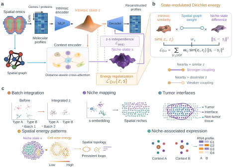

# NicheEnergy

NicheEnergy is a disentanglement-based self-supervised framework for identifying spatial niches. It learns intrinsic and niche states within a variational autoencoder using disentangled representation learning and state-modulated Dirichlet energy. NicheEnergy provides label-free niche identification across tissues and modalities and is implemented with scvi-tools and PyTorch.



## System requirements
### OS requirements
The tutorial uses an NVIDIA GPU and has been run on Linux x86_64 with Python 3.10.14 and PyTorch 2.5.1.

### Dependencies
See [setup.cfg](https://github.com/ZzzsHuqiaAao/NicheEnergy/blob/main/setup.cfg) for package dependencies and [config.txt](https://github.com/ZzzsHuqiaAao/NicheEnergy/blob/main/config.txt) for the pinned package versions.

## Installation

NicheEnergy requires Python 3.10. Install with:

```bash
pip install nicheenergy
```

See the [installation guide](https://github.com/ZzzsHuqiaAao/NicheEnergy/blob/main/nicheenergy/INSTALL.md) for GPU setup and installation from source.

## Documentation
The [MERFISH tutorial](https://github.com/ZzzsHuqiaAao/NicheEnergy/blob/main/NicheEnergy_tutorial_MERFISH.ipynb) shows training loss, z/s UMAPs colored by cell type, reference cortical layers and batch, spatial niche identification, state-modulated Dirichlet energy, and saving results. Dataset preparation and the study analyses are in the companion [NicheEnergy_reproducibility](https://github.com/ZzzsHuqiaAao/NicheEnergy_reproducibility) repository.

## Usage

For detailed usage, follow our tutorial:

- [Getting Started with NicheEnergy](https://github.com/ZzzsHuqiaAao/NicheEnergy/blob/main/NicheEnergy_tutorial_MERFISH.ipynb)

Data and preparation:

- [Original human MERFISH MTG data](https://drive.google.com/drive/folders/1jeAZge-0wJ1gkHEKC4P6PIalumn2A68p?usp=sharing)
- [MTG input preparation](https://github.com/ZzzsHuqiaAao/NicheEnergy_reproducibility/blob/main/benchmarking/MTG.ipynb) (`input.h5ad` and `obs.csv.gz`)
